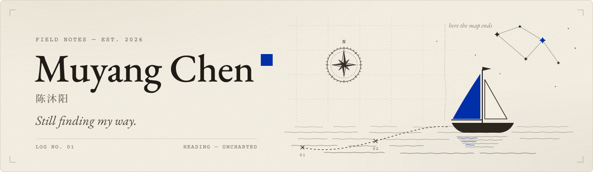

  

  <a href="https://muyangchen.me/">Blog</a> &nbsp; · &nbsp;
  <a href="https://muyangchen.me/contact/">Say hello</a>

## Hi, I'm Muyang.

I build little tools, follow my curiosity, and try to find connections between the things I learn.

### 🧭 On my map

| Engineering | Economics | Knowledge |
| :--- | :--- | :--- |
| Making AI coding more reliable, and collecting practices that hold up in real projects. | Learning how the world economy evolves, and looking for elegant structures beneath its complexity. | Exploring connections between ideas with AI, and learning where my own knowledge ends and what I want to pursue. |

☁️ I enjoy building with **Cloudflare's serverless stack**. It's where my services live.

Previously, I helped maintain [**hikyuu**](https://github.com/fasiondog/hikyuu). Working on it taught me a lot about software engineering.

### ✨ Small things I love

**Anime.** Ask me about *A Place Further than the Universe*. It reminds me what youth feels like.

**Maid cafés.** A little shout-out to **kagari at 天气愈告**, a maid café in Hangzhou. I love kagari's energy, and my first cheki (instant photo) was with kagari.

**Books.** I enjoy reading, including *Nonviolent Communication* and *The Pyramid Principle*.

---

> Learning feels a bit like sailing: figuring out where my map ends, and where I want to go next.

If something here caught your interest, [come say hello](https://muyangchen.me/contact/).
